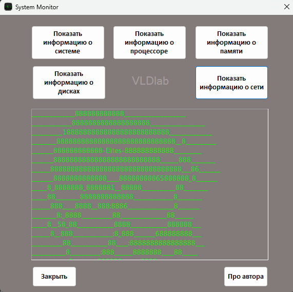
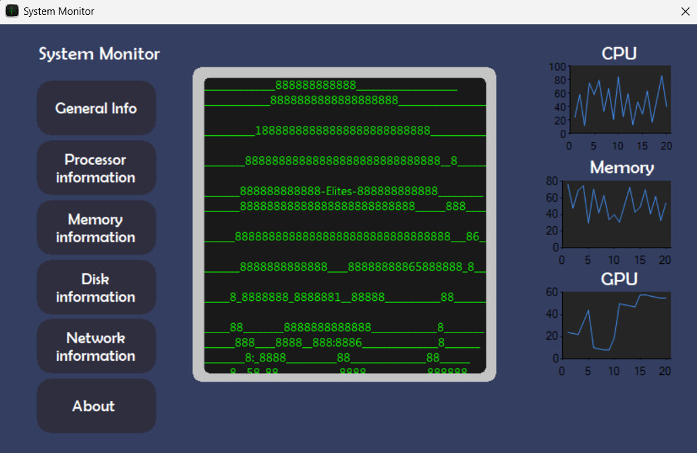

# 🖥️ Visual System Monitor


Легковесная десктопная утилита для мониторинга аппаратных ресурсов и сетевой конфигурации Windows в реальном времени. Проект объединяет низкоуровневый нативный бэкенд на C++ (WinAPI / Winsock) и графический интерфейс на базе Windows Forms.

---

## 📸 Скриншот прошлого дизайна





## 📸 Скриншот нового дизайна




---

## ✨ Возможности

* **Мониторинг процессора и памяти:** получение информации об архитектуре ЦП, количестве логических ядер и текущем состоянии оперативной памяти (ОЗУ) через `WinAPI`.
* **Анализ дискового пространства:** отслеживание доступного и занятого объема накопителей с использованием библиотеки `std::filesystem` (C++20).
* **Сетевая диагностика:** определение имени хоста и локальных IP-адресов с помощью сокетов Windows (`Winsock2`).
* **Портативность:** приложение собрано в конфигурации `Release` как автономный оконный `.exe`-файл (`/SUBSYSTEM:WINDOWS`) без фоновой консоли.

---

## 🚀 Быстрый запуск (Для пользователей)

1. Перейдите в раздел **[Releases](https://github.com/VLDLab/VisualSystemMonitor/releases)** справа.
2. Скачайте актуальную версию `VisualSystemMonitor.exe` (или ZIP-архив).
3. Запустите файл.
   * *Примечание:* Поскольку бинарный файл не подписан платным коммерческим сертификатом, при первом запуске Windows SmartScreen может показать предупреждение. Нажмите **«Подробнее»** ➔ **«Выполнить в любом случае»**.

---

## 🛠️ Сборка из исходного кода (Для разработчиков)

### Требования
* **ОС:** Windows 10 / 11 (x64)
* **IDE:** Visual Studio 2022 (с установленным компонентом *«Разработка классических приложений на C++»* и поддержкой **C++/CLI**)
* **Windows SDK:** 10.0 или новее

### Инструкция по сборке
1. Клонируйте репозиторий:
   ```bash
   git clone [https://github.com/VLDLab/VisualSystemMonitor.git](https://github.com/VLDLab/VisualSystemMonitor.git)
